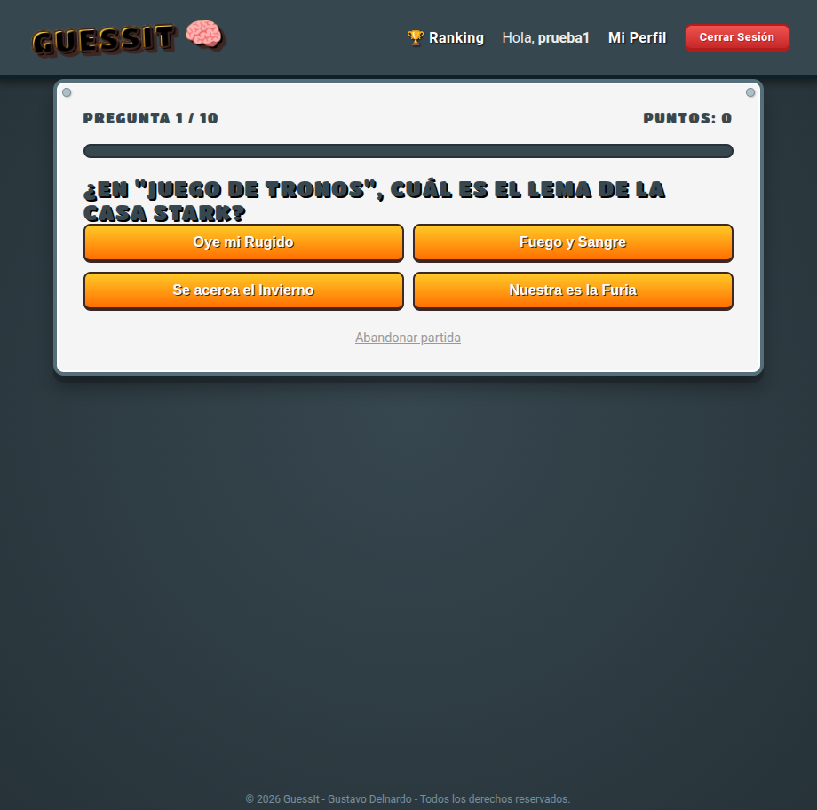

# GuessIt

Juego de preguntas de cultura general hecho con PHP y MySQL. Te registras, juegas partidas de 10 preguntas al azar y compites en un ranking con el resto de jugadores.

Proyecto de 1.º de DAM, sin frameworks.

Capturas: [gustavo-delnardo.vercel.app/portfolio/guessit](https://gustavo-delnardo.vercel.app/portfolio/guessit)

| Inicio | Partida | Ranking |
|:---:|:---:|:---:|
|  |  |  |

## Qué hace

- **Cuentas de usuario:** registro e inicio de sesión. Las contraseñas se guardan con `password_hash` (bcrypt) y se comprueban con `password_verify`.
- **Partidas:** se eligen 10 preguntas al azar y las opciones salen en orden aleatorio. El progreso se guarda en la sesión, así que recargar la página no rompe la partida.
- **Perfil:** partidas jugadas, mejor puntuación y media.
- **Ranking:** los 10 mejores jugadores según su mejor partida, calculado con una consulta con `JOIN`, `GROUP BY` y `MAX`.
- **Preguntas:** 50 preguntas de cultura general (ciencia, historia, geografía, cine...).

## Detalles técnicos

- **PHP 8** procedural, con cabecera y pie compartidos en `templates/`.
- **MySQL** con **PDO** y consultas preparadas.
- El servidor comprueba que la respuesta enviada pertenece a la pregunta actual, para que no se pueda sumar puntos enviando el id de otra respuesta.
- Los textos que vienen de la base de datos o del usuario se escapan con `htmlspecialchars` antes de mostrarlos.
- Los errores de base de datos se guardan en el log del servidor y el usuario solo ve un mensaje genérico.
- **CSS** escrito a mano, sin Bootstrap ni Tailwind, con las fuentes Titan One y Roboto.

## Estructura

```text
GuessIt/
├── assets/          # CSS e imágenes
├── config/
│   └── db.php.example   # Plantilla de conexión (copiar como db.php)
├── database/
│   ├── schema.sql           # Tablas: users, questions, options, games
│   ├── seeds.sql            # 5 preguntas de prueba
│   └── expansion_pack.sql   # Las 50 preguntas (vacía la tabla y las carga todas)
├── templates/       # Cabecera y pie
├── index.php        # Portada
├── register.php, login.php, logout.php
├── play.php         # Partida
├── result.php       # Resultado y guardado de la partida
├── dashboard.php    # Perfil con estadísticas
└── ranking.php      # Ranking
```

## Instalación en local

Necesitas PHP 8 con la extensión `pdo_mysql` y MySQL o MariaDB.

1. Clona el repositorio:
   ```bash
   git clone https://github.com/soytavodev/GuessIt.git
   cd GuessIt
   ```
2. Crea la base de datos y carga las tablas y las preguntas:
   ```bash
   mysql -u root -p -e "CREATE DATABASE guessit_db CHARACTER SET utf8mb4 COLLATE utf8mb4_unicode_ci"
   mysql -u root -p guessit_db < database/schema.sql
   mysql -u root -p guessit_db < database/expansion_pack.sql
   ```
3. Copia la configuración y pon tus datos de MySQL:
   ```bash
   cp config/db.php.example config/db.php
   ```
4. Arranca el servidor de PHP y abre `http://localhost:8000`:
   ```bash
   php -S localhost:8000
   ```

## Autor

Gustavo Delnardo · [GitHub](https://github.com/soytavodev) · [Web](https://gustavo-delnardo.vercel.app)
